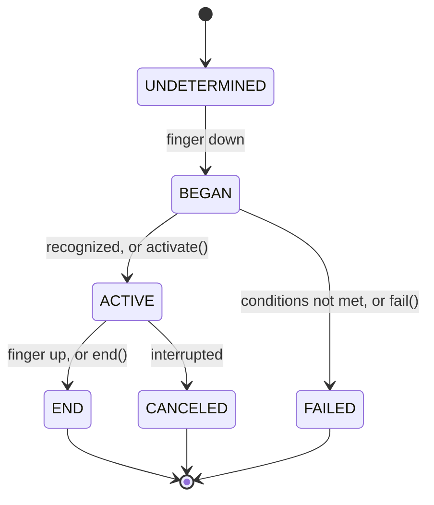

# Gesture lifecycle

The states a gesture moves through, the callbacks that mark each step, and `GestureStateManager` for changing state from a callback. `import { GestureState, GestureStateManager } from '@blotch/angular-lynx';`

## Usage

```typescript
readonly pan = new PanGesture()
  .onUpdate((event, state) => {
    // A mostly vertical drag isn't ours: let a scroll view take it.
    if (Math.abs(event.translationY) > Math.abs(event.translationX)) {
      state.fail();
      return;
    }
    this.offset.set(event.translationX);
  });
```

Every callback gets the event and a `GestureStateManager` for that gesture on that element.

## States



| State          | Value | Meaning                                                      |
| -------------- | ----- | ------------------------------------------------------------ |
| `UNDETERMINED` | `0`   | No finger is down yet                                        |
| `BEGAN`        | `1`   | A finger is down, and the gesture is checking its conditions |
| `ACTIVE`       | `2`   | The gesture is recognized                                    |
| `END`          | `3`   | The gesture finished                                         |
| `FAILED`       | `4`   | Its conditions weren't met, such as a tap that moved too far |
| `CANCELED`     | `5`   | Something else took over while it was active                 |

The event's `state` field is usually absent. The callback that fires tells you the step.

## Callbacks

| Callback        | Fires when                                                    | Gestures                            |
| --------------- | ------------------------------------------------------------- | ----------------------------------- |
| `onBegin`       | A finger touches down and the gesture starts checking (BEGAN) | All. A fling: when the finger lifts |
| `onStart`       | The gesture is recognized (ACTIVE)                            | All                                 |
| `onUpdate`      | The finger moves while the gesture is ACTIVE                  | Pan, Fling, Pinch, Rotation         |
| `onEnd`         | The gesture finishes (END)                                    | All                                 |
| `onTouchesDown` | A finger touches the element                                  | All                                 |
| `onTouchesUp`   | A finger lifts                                                | All                                 |

A successful tap runs `onStart`, then `onEnd`. A long press runs `onStart` once the hold is long enough, and `onEnd` when the finger lifts. A fling runs `onBegin`, `onUpdate` on every frame and `onEnd`, but never `onStart` (see [FlingGesture](/api/gestures/gesture-types#flinggesture)).

You don't need to register `onBegin` for the others to fire. Lynx skips a fling's `onStart` and `onEnd` when no `onBegin` is registered, and did the same for a pan before Lynx 3.9, so AngularLynx registers an empty one on every pan, fling, pinch and rotation that has none.

### Failed and canceled gestures

There's no `onFail` or `onCancel` callback.

- **Tap and long press:** Lynx also calls `onEnd` when the gesture fails. AngularLynx drops that call, so `onEnd` fires only after `onStart`. Use either one to mean "it happened".
- **Pan, Fling, Pinch and Rotation:** AngularLynx passes `onEnd` through as Lynx sends it. Don't assume a pan's `onEnd` means success. Check your own state instead.

### Callback signature

```typescript
type GestureCallbackWithState<TEvent extends GestureEvent = GestureEvent> = (
  event: TEvent,
  stateManager: GestureStateManager,
) => void;
```

`TEvent` is the gesture's event type, such as `PanGestureEvent` (see [Gesture types](/api/gestures/gesture-types)). Callbacks run on the [main thread](/guide/glossary#main-thread), inside the native gesture. Setting signals there is safe, but don't add or remove elements until the gesture ends (see the [`setTimeout` rule](/guide/concepts/threads#the-settimeout-rule)).

## API

`GestureStateManager` is the second argument of every callback. You don't create one yourself.

### `activate()`

```typescript
activate(): void;
```

Moves the gesture to ACTIVE now, without waiting for its own conditions, such as `minDistance`. Use it in `onBegin` or `onUpdate` once your own check passes.

### `fail()`

```typescript
fail(): void;
```

Moves the gesture to FAILED, so it stops tracking this touch. Gestures that [`waitFor`](/api/gestures/#waitforgestures) it can then activate, and a parent scroll view can take the touch.

### `end()`

```typescript
end(): void;
```

Moves an active gesture to END, as if the finger had lifted. Use it to stop a drag at a limit, for example.

### `consumeGesture(consume?)`

```typescript
consumeGesture(consume = true): void;
```

Keeps this gesture from reaching the element's ancestors. Their gestures and scroll views don't respond to the touch as well. Call `consumeGesture(false)` to let them respond again.

### `interceptGesture(intercept?)`

```typescript
interceptGesture(intercept = true): void;
```

The opposite direction: claims the touch from the element's descendants, before they handle it. Use it on a parent, such as a pull-to-refresh container that takes over its list's scroll. Call `interceptGesture(false)` to release it.

## Types

```typescript
enum GestureState {
  UNDETERMINED = 0,
  BEGAN = 1,
  ACTIVE = 2,
  END = 3,
  FAILED = 4,
  CANCELED = 5,
}

// The callback type without the state manager.
type GestureCallback<TEvent extends GestureEvent = GestureEvent> = (
  event: TEvent,
) => void;
```

## Related

- [Gestures guide](/guide/gestures/)
- [`[lynxGesture]` and composition](/api/gestures/)
- [Gesture types](/api/gestures/gesture-types)
