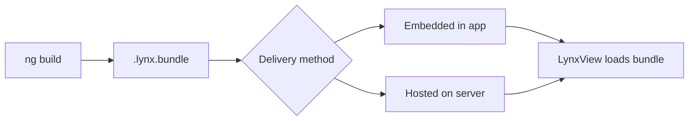

# Publishing your App

This guide covers how to build your AngularLynx app into a production bundle, and from it the iOS and Android apps you submit to the App Store and Google Play.

## Build Command

Run the production build from your project root:

```bash
ng build
```

This compiles your Angular components, templates, styles, and assets into optimized `.lynx.bundle` files in the `dist/` directory. `ng build` runs the `@blotch/angular-lynx-build:application` builder, which runs RSpeedy with the AngularLynx plugin. It takes the entry point from the build target's `browser` option and builds both the native bundle and the web preview bundle.

**Configurations work as in any Angular app.** `ng build` uses the build target's `defaultConfiguration` (`production` after `ng add`). `ng build -c development` builds the development one, and flags like `--source-map` override single options. `ng serve -c production` serves a production build.

**`optimization` decides between a production and a development build.** As in Angular, a build that optimizes scripts is a production build, and one that doesn't (`"optimization": false`, as in `ng new`'s development configuration) is a development build with dev mode on. There is no separate mode option.

**`ng build --watch` rebuilds on every change**, like `npm run watch`, which `ng new` adds. It rebuilds the bundle only, so it can't be combined with `--platform`.

### Budgets

The `budgets` in your build configuration are enforced, with the same units and messages as `ng build` for a web app: a warning is printed, an error fails the build. They are checked against the Lynx bundle (each entry's bundle is its own `initial` budget) and against each component stylesheet (`anyComponentStyle`). The web preview bundle isn't checked.

`ng add` raises the `initial` budget `ng new` writes (500 kB warning, 1 MB error) to 2 MB and 5 MB. A Lynx bundle holds Angular twice, once for each of Lynx's threads, so a new app's bundle is already about 1 MB. See the [plugin's README](https://github.com/Blotch-Smart-Frames/AngularLynx/tree/master/packages/rsbuild-plugin-angular-lynx#budgets) for what each budget type measures.

### Customizing RSpeedy

An app doesn't need a `lynx.config.ts`. Add one to change something RSpeedy does, such as its environments, entries, or the AngularLynx plugin's options; whatever it doesn't set still comes from `angular.json`. Import `defineConfig` and the plugin from `@blotch/angular-lynx-build`, which brings RSpeedy with it:

```typescript title="lynx.config.ts"
import { defineConfig, pluginAngularLynx } from '@blotch/angular-lynx-build';

export default defineConfig({
  plugins: [pluginAngularLynx({ enableSSR: true })],
});
```

## Output Files

After building, your `dist/` directory looks like this:

```
dist/
├── main.lynx.bundle            # Your app's main bundle
└── static/
    ├── image/
    │   └── logo.a1b2c3.png     # Hashed image assets
    ├── svg/
    │   └── icon.d4e5f6.svg
    └── font/
        └── custom.g7h8i9.woff2
```

| File               | Purpose                                                 |
| ------------------ | ------------------------------------------------------- |
| `main.lynx.bundle` | The primary bundle loaded when your app starts          |
| `static/`          | Images, fonts, and other assets referenced in your code |

:::tip
Lazy-loaded routes (`loadComponent(() => import('./path'))`) and `@defer` blocks are built into `main.lynx.bundle`. They still load lazily in your code, but no separate bundle has to be fetched. See [Routing](/guide/routing) for more on lazy loading.
:::

## Building the iOS and Android Apps

Add `--platform` and the same command builds the store binaries:

```bash
ng build --platform ios       # dist/ios/MyApp.ipa and dist/ios/MyApp-simulator.app
ng build --platform android   # dist/android/my-app.aab and dist/android/my-app.apk
ng build --platform all
```

You never see an Xcode or Gradle project. The builder generates one into Angular's build cache (`.angular/cache/`, which `ng new` already git-ignores), copies your bundle into it, and builds it. The generated project is reused until your options change, so a rebuild takes seconds. `ng cache clean` deletes it, and the next build generates it again.

| Output                         | Use                                                                                  |
| ------------------------------ | ------------------------------------------------------------------------------------ |
| `dist/ios/MyApp-simulator.app` | Drag onto a simulator, or `xcrun simctl install booted dist/ios/MyApp-simulator.app` |
| `dist/ios/MyApp.ipa`           | Upload to TestFlight and the App Store. Only built when iOS signing is configured    |
| `dist/android/my-app.apk`      | Install on an emulator or device with `adb install`                                  |
| `dist/android/my-app.aab`      | Upload to Google Play                                                                |

**Requirements:** iOS builds need macOS with Xcode (Apple only ships its build tools for macOS). Android builds need JDK 17 or newer and the Android SDK, which Android Studio installs.

### App identity

The app's name, ID and version are options of the `build` target in `angular.json`. `ng add` sets `appName` and a placeholder `appId`; replace the ID before your first upload, because the stores identify your app by it.

```json title="angular.json"
"build": {
  "builder": "@blotch/angular-lynx-build:application",
  "options": {
    "appName": "My App",
    "appId": "com.example.myapp",
    "version": "1.2.0",
    "buildNumber": 42,
    "icon": "src/assets/icon.png",
    "orientation": "portrait",
    "permissions": { "camera": "Scan receipts" },
    "deepLinkSchemes": ["myapp"]
  }
}
```

| Option            | Description                                                                                                       |
| ----------------- | ----------------------------------------------------------------------------------------------------------------- |
| `appName`         | The name under the icon. Defaults to the project name                                                             |
| `appId`           | The iOS bundle ID and Android application ID. Letters and digits in dot-separated parts                           |
| `version`         | The version users see. Defaults to `package.json`'s version                                                       |
| `buildNumber`     | Must increase with every store upload                                                                             |
| `icon`            | A 1024×1024 PNG without transparency                                                                              |
| `orientation`     | `portrait` (default), `landscape` or `all`                                                                        |
| `permissions`     | `camera`, `microphone`, `location`, `photos`, `contacts`, `notifications`, each with the reason shown to the user |
| `deepLinkSchemes` | URL schemes that open the app                                                                                     |

Use Angular's `configurations` for per-environment values, e.g. `"staging": { "appId": "com.example.myapp.staging" }` and `ng build --platform ios --configuration staging`. Angular merges configurations one key deep, so a configuration that sets `ios` or `android` replaces that whole object.

### Signing

Signing secrets never go in `angular.json`: the options name the environment variables that hold them.

```json title="angular.json"
"ios": {
  "teamId": "ABCDE12345",
  "signing": { "keyIdEnv": "ASC_KEY_ID", "issuerIdEnv": "ASC_ISSUER_ID", "keyPathEnv": "ASC_KEY_PATH" }
},
"android": {
  "signing": {
    "storeFileEnv": "UPLOAD_KEYSTORE",
    "storePasswordEnv": "UPLOAD_STORE_PASSWORD",
    "keyAlias": "upload",
    "keyPasswordEnv": "UPLOAD_KEY_PASSWORD"
  }
}
```

- **iOS** uses an [App Store Connect API key](https://developer.apple.com/documentation/appstoreconnectapi/creating-api-keys-for-app-store-connect-api) with the App Manager role. Xcode creates the certificate and provisioning profile itself, so you never open Xcode. Without signing, only the simulator app is built.
- **Android** uses your Google Play upload key. Without it, the release build is signed with a debug key: it installs on emulators and devices, but Google Play rejects it.

### Customizing the native project

When you need a native change the options don't cover, eject:

```bash
ng generate @blotch/angular-lynx:eject                    # both platforms
ng generate @blotch/angular-lynx:eject --platform ios
```

This writes the generated projects into `ios/` and `android/`, where you edit and commit them. `ng build --platform` then builds those folders as they are. Ejecting is one-way: the app options in `angular.json` stop applying to an ejected project, and keeping it current with new Lynx, Xcode and Google Play requirements becomes your job. Delete the folder to go back to the generated project.

## Embedding in an Existing App

If you already have a native app, embed the bundle in it instead of using the generated one.

Lynx apps run inside a **native host app** that embeds the Lynx engine. You provide the `.lynx.bundle` files; the host app loads them into a `LynxView`.



### Embedded vs Remote Bundles

| Strategy                                          | Pros                                       | Cons                                        |
| ------------------------------------------------- | ------------------------------------------ | ------------------------------------------- |
| **Embedded** — ship bundles inside the app binary | Instant load, works offline                | Requires app store update to change content |
| **Remote** — host bundles on a CDN                | Update without app store release, A/B test | Needs network for first load                |

:::tip
Combine both: ship a baseline bundle with the app for instant first launch, then check for remote updates in the background.
:::

### Over-the-Air Updates

With remote bundles, deploy a new `.lynx.bundle` to your server and users get the update on next launch — no app store review needed.

:::note
Setting up the native host app (Lynx SDK, `LynxView`, bundle loading) is handled by the native team. See:

- [Integrate with Existing Apps](https://lynxjs.org/guide/start/integrate-with-existing-apps.html)
- [Embedding LynxView](https://lynxjs.org/guide/embed-lynx-to-native.html)

:::

## Production Checklist

Before deploying, verify:

- **Error handling** — Confirm your [error handler](/guide/error-handling) is configured (remove any on-screen debug overlays)
- **Accessibility** — The [accessibility inspector](/guide/accessibility) is disabled by default in production builds
- **Bundle size** — Set [budgets](#budgets) that fail the build when the bundle grows; lazy-load heavy routes to keep the main bundle small
- **Remote logging** — Set up [remote logging](/guide/remote-logging) so you can diagnose issues on-device
- **Host data** — Coordinate with the native team on [InitData](/guide/host-data/init-data) and [GlobalData](/guide/host-data/global-data) contracts
