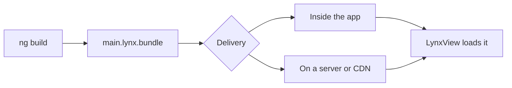

# Publishing your App

One command turns your app into iOS and Android apps you can submit to the App Store and Google Play:

```bash
ng build --platform all
```

This page covers building the bundle and the apps, naming and signing them, and uploading them. Already have a native app? See [Embed in an existing native app](#embed-in-an-existing-native-app).

## Build the bundle

```bash
ng build
```

This compiles your app into **Lynx bundles**: single files holding your code, templates and styles, which the Lynx engine runs. They land in `dist/`, or in the build target's `outputPath` if you set one:

```
dist/
├── main.lynx.bundle
├── main.web.bundle
└── static/
    ├── image/
    │   └── logo.bf916cea19.png
    └── font/
        └── Inter-Regular.275384a067.ttf
```

| File               | What it is                                                                                             |
| ------------------ | ------------------------------------------------------------------------------------------------------ |
| `main.lynx.bundle` | Your app, as iOS and Android run it                                                                    |
| `main.web.bundle`  | The same app for the web preview                                                                       |
| `static/`          | Images, fonts, SVGs and media your code imports. Files under 2 KiB are inlined into the bundle instead |

`ng build` runs the `@blotch/angular-lynx-build:application` builder. It bundles with [RSpeedy](https://lynxjs.org/rspeedy/), Lynx's build tool, and takes the entry point from the build target's `browser` option, as in any Angular app.

:::tip Lazy code ships in the main bundle
Lazy routes (`loadComponent()`) and `@defer` blocks work as written. Their code is built into `main.lynx.bundle`, though, not into separate files, so lazy loading doesn't make the bundle smaller. See [Routing](/guide/routing) for more on lazy routes.
:::

### Production and development builds

`ng build` makes a **production build**: minified, with Angular's dev mode off and AngularLynx's debug and profiling code compiled out.

As in Angular, the `optimization` option decides which build you get. There's no separate mode option.

- `ng build` uses the build target's `defaultConfiguration`, which is `production` after `ng add`.
- `ng build -c development` builds `ng new`'s development configuration (`"optimization": false`), with dev mode on.
- Flags override single options, e.g. `ng build --source-map`.
- `ng serve -c production` serves a production build.

### Rebuild on every change

```bash
ng build --watch
```

This rebuilds the bundle whenever a file changes, like the `npm run watch` script `ng new` adds. It can't be combined with `--platform`: use `ng serve` while developing.

## Build the iOS and Android apps

Add `--platform` to build the apps:

```bash
ng build --platform ios       # dist/ios/
ng build --platform android   # dist/android/
ng build --platform all       # both
```

| Output                         | Use it to                                                                                                 |
| ------------------------------ | --------------------------------------------------------------------------------------------------------- |
| `dist/ios/MyApp-simulator.app` | Run on the iOS Simulator: drag it onto one, or `xcrun simctl install booted dist/ios/MyApp-simulator.app` |
| `dist/ios/MyApp.ipa`           | Upload to TestFlight and the App Store. Only built once [iOS signing](#ios) is set up                     |
| `dist/android/my-app.apk`      | Install on an emulator or device with `adb install`                                                       |
| `dist/android/my-app.aab`      | Upload to Google Play                                                                                     |

The file names come from your app's [`appName`](#set-the-app-identity).

**Requirements:**

- **iOS:** macOS with Xcode. Apple only ships its build tools for macOS.
- **Android:** JDK 17 or newer, and the Android SDK, which Android Studio installs.

**You never see an Xcode or Gradle project.** The builder generates one in Angular's build cache (`.angular/cache/`, which `ng new` already git-ignores), copies your bundle into it, and builds it. The project is reused until your options change, so a rebuild takes seconds. `ng cache clean` deletes it, and the next build generates it again.

:::note
The generated app shows `main.lynx.bundle` full screen, and Angular Router handles all navigation inside it. It doesn't open the other bundles of a [multi-page](/guide/multi-page) app: for those, [eject](#customize-the-native-project) or [embed them in your own app](#embed-in-an-existing-native-app).
:::

## Set the app identity

The app's name, ID and version are options of the `build` target in `angular.json`:

```json title="angular.json"
"build": {
  "builder": "@blotch/angular-lynx-build:application",
  "options": {
    "appName": "My App",
    "appId": "com.example.myapp",
    "version": "1.2.0",
    "buildNumber": 42,
    "icon": "src/assets/icon.png",
    "orientation": "portrait",
    "permissions": { "camera": "Scan receipts" },
    "deepLinkSchemes": ["myapp"]
  }
}
```

:::warning Replace the placeholder app ID
`ng add` sets `appId` to a placeholder, `com.example.<project>`. Replace it before your first upload: the stores identify your app by its ID, and it can't change afterwards.
:::

| Option            | Description                                                                                                                                                     |
| ----------------- | --------------------------------------------------------------------------------------------------------------------------------------------------------------- |
| `appName`         | The name under the icon. Defaults to the project name                                                                                                           |
| `appId`           | The iOS bundle ID and Android application ID. Two or more dot-separated parts of letters and digits, each starting with a letter                                |
| `version`         | The version users see, up to three numbers (`1.2.0`). Defaults to `package.json`'s version, or `1.0.0` while that's still `ng new`'s `0.0.0`                    |
| `buildNumber`     | Must increase with every store upload. Defaults to `1`                                                                                                          |
| `icon`            | A 1024×1024 PNG without transparency. iOS only for now: Android apps get a placeholder icon                                                                     |
| `orientation`     | `portrait` (default), `landscape` or `all`                                                                                                                      |
| `permissions`     | Any of `camera`, `microphone`, `location`, `photos`, `contacts` and `notifications`, each with the reason iOS shows when it asks. Android shows its own message |
| `deepLinkSchemes` | URL schemes that open the app, e.g. `myapp` for `myapp://` links                                                                                                |

**Use Angular's `configurations` for per-environment values:**

```json title="angular.json"
"configurations": {
  "staging": { "appId": "com.example.myapp.staging", "appName": "My App (Staging)" }
}
```

```bash
ng build --platform ios -c staging
```

Angular merges a configuration into the options one key deep. So a configuration that sets `ios` or `android` replaces that whole object.

## Sign for the stores

The stores only accept signed apps. Signing secrets never go in `angular.json`: the signing options name the **environment variables** that hold them. Add them to the same `options`:

```json title="angular.json"
"options": {
  "ios": {
    "teamId": "ABCDE12345",
    "signing": {
      "keyIdEnv": "ASC_KEY_ID",
      "issuerIdEnv": "ASC_ISSUER_ID",
      "keyPathEnv": "ASC_KEY_PATH"
    }
  },
  "android": {
    "signing": {
      "storeFileEnv": "UPLOAD_KEYSTORE",
      "storePasswordEnv": "UPLOAD_STORE_PASSWORD",
      "keyAlias": "upload",
      "keyPasswordEnv": "UPLOAD_KEY_PASSWORD"
    }
  }
}
```

Then set those variables, e.g. as secrets in CI, and build. If signing is only partly set up, the build fails and names what's missing.

### iOS

iOS signing uses an [App Store Connect API key](https://developer.apple.com/documentation/appstoreconnectapi/creating-api-keys-for-app-store-connect-api):

- `teamId` is your Apple Developer team ID. Signing needs it.
- `keyIdEnv` and `issuerIdEnv` name the variables holding the key's ID and issuer ID.
- `keyPathEnv` names the variable holding the path to the key's `.p8` file.

Xcode creates the certificate and provisioning profile itself, so you never open Xcode. Without signing, only the simulator app is built.

:::warning Not yet tested with a real account
iOS signing hasn't been verified against a real App Store Connect account yet. Use a key with the **Admin** role, which Xcode may need to create a distribution certificate. If signing fails, please [open an issue](https://github.com/Blotch-Smart-Frames/AngularLynx/issues).
:::

### Android

Android signing uses your Google Play **upload key**, a keystore you [generate once](https://developer.android.com/studio/publish/app-signing#generate-key):

- `storeFileEnv` names the variable holding the keystore's path.
- `storePasswordEnv` and `keyPasswordEnv` name the variables holding its passwords.
- `keyAlias` is the key's alias itself, not a variable.

Without signing, the release build is signed with a debug key. It installs on emulators and devices, but Google Play rejects it.

## Upload to the stores

`ng build` doesn't upload for you yet:

- **App Store:** [upload `MyApp.ipa` to App Store Connect](https://developer.apple.com/help/app-store-connect/manage-builds/upload-builds), e.g. with Apple's Transporter app. Test it in TestFlight, then submit it for review.
- **Google Play:** create your app in the [Play Console](https://play.google.com/console) and upload `my-app.aab` to a release, e.g. on the internal testing track first.

## Before you ship

- **App ID:** you've replaced `ng add`'s `com.example.*` placeholder.
- **Build number:** it's higher than in your last upload.
- **The built app works:** install `MyApp-simulator.app` or `my-app.apk` and try it. That's what your users get, not Lynx Explorer.
- **No debug output:** remove on-screen debugging aids such as an [error display](/guide/error-handling#on-device-debugging).
- **Crash reporting:** [`LynxLogger`](/guide/remote-logging) only reaches your dev server, so it's silent in shipped apps. To hear about your users' errors, send them to your own service from a [custom error handler](/guide/error-handling#custom-error-handling).
- **Bundle size:** [budgets](#budgets) fail the build when the bundle grows past a limit.

## Customize the build

### Budgets

The `budgets` in your build configuration work as in a web app, with the same units and messages: over a warning size the build prints a warning, and over an error size it fails. They're checked against:

- each entry's Lynx bundle, as its `initial` budget;
- each component stylesheet (`anyComponentStyle`).

The web preview bundle isn't checked.

`ng add` raises `ng new`'s `initial` budget from 500 kB (warning) and 1 MB (error) to 2 MB and 5 MB. A Lynx bundle holds Angular twice, once for each of [Lynx's two threads](/guide/renderer-architecture), so a new app's bundle is already about 1 MB. The [plugin's README](https://github.com/Blotch-Smart-Frames/AngularLynx/tree/master/packages/rsbuild-plugin-angular-lynx#budgets) explains what each budget type measures.

### Customize RSpeedy

An app doesn't need a `lynx.config.ts`. Add one to change something RSpeedy does, such as its environments, its entries or the AngularLynx plugin's options. Whatever it doesn't set still comes from `angular.json`.

Import `defineConfig` and the plugin from `@blotch/angular-lynx-build`, which brings RSpeedy with it:

```typescript title="lynx.config.ts"
import { defineConfig, pluginAngularLynx } from '@blotch/angular-lynx-build';

export default defineConfig({
  plugins: [pluginAngularLynx({ enableSSR: true })],
});
```

### Customize the native project

For a native change the options don't cover, **eject**:

```bash
ng generate @blotch/angular-lynx:eject                    # both platforms
ng generate @blotch/angular-lynx:eject --platform ios
```

This writes the generated projects into `ios/` and `android/`, where you edit and commit them. `ng build --platform` then builds those folders as they are, with your latest bundle and signing.

Ejecting is one-way:

- The identity options in `angular.json` (name, ID, version, icon, permissions and so on) stop applying. The signing options still apply.
- Keeping the project current with new Lynx, Xcode and Google Play requirements becomes your job.

To go back to the generated project, delete the folder.

## Embed in an existing native app

Already have an iOS or Android app? Show your Angular app inside it instead of using the generated one.

Your app embeds the Lynx engine and loads the bundle into a **`LynxView`**, a native view that runs a Lynx bundle. Lynx's guides cover the native setup:

- [Integrate with Existing Apps](https://lynxjs.org/guide/start/integrate-with-existing-apps) adds Lynx to your app. Pick your platform from the tabs.
- [Embedding LynxView into Native View](https://lynxjs.org/guide/embed-lynx-to-native) sizes a `LynxView` inside your own screens.

Your app also has to:

- **Load the bundle.** The Lynx engine doesn't fetch bundles itself. Your app provides a loader (`AbsTemplateProvider` on Android, `LynxTemplateProvider` on iOS) that reads them from the app or the network.
- **Serve `static/`.** Imported images and fonts load from `/static/...` paths. Resolve those against where your app keeps `static/`, as the generated apps do, or set RSpeedy's `output.assetPrefix` to a URL where you host them.
- **Link XElement.** See the warning below.

:::warning Link XElement, or some elements render nothing
`<input>`, `<textarea>`, `<overlay>`, `<svg>`, `<blur-view>`, `<viewpager>`, `<refresh>`, the `<scroll-coordinator>` family, `<webview>` and `<video>` aren't part of Lynx's core. They come from Lynx's **XElement** library.

An app that doesn't link XElement and register its elements renders nothing for these tags. On Android, the elements after them can disappear too. Nothing on screen says why.

- **Android:** add `org.lynxsdk.lynx:xelement` and call `addBehaviors(XElementBehaviors().create())` on the `LynxViewBuilder`.
- **iOS:** add the `XElement` pod.

Lynx's [integration guide](https://lynxjs.org/guide/start/integrate-with-existing-apps) has the details. The apps `ng build --platform` generates already do this, and so does Lynx Explorer.
:::

### Bundled or downloaded

Your app can ship the bundle inside it, or download it from a server:



| Strategy                                | Pros                                          | Cons                                        |
| --------------------------------------- | --------------------------------------------- | ------------------------------------------- |
| **Bundled:** ship it inside the app     | Loads instantly, works offline                | Changing the app needs a store update       |
| **Downloaded:** host it on a server/CDN | Update without a store release, run A/B tests | Needs the network, at least on first launch |

:::tip
Combine both: ship a bundle with the app for an instant first launch, then check for a newer one in the background.
:::

Before you serve updates this way:

- **Match the Lynx version.** A bundle only runs on a Lynx engine at least as new as its `targetSdkVersion`, an AngularLynx plugin option that defaults to `3.2`. Every installed version of your app must be able to run what you serve.
- **Check the store rules.** Both stores have rules about code an app downloads.

### Pass data from your app

Your app can pass data into Angular: [InitData](/guide/host-data/init-data) when it creates a `LynxView`, and [GlobalData](/guide/host-data/global-data) that every `LynxView` shares. The generated apps pass none.
