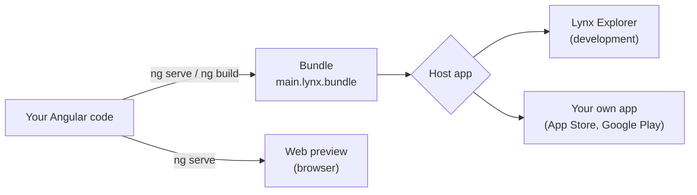

# How a Lynx app runs

This page explains the pieces between your code and a phone screen: the bundle, the host app, Lynx Explorer and the web preview. Once you know them, the dev workflow and the build commands make sense.

## The short version

1. The build compiles your app into a single file: the **bundle**.
2. A **host app**, a native iOS or Android app, loads that bundle and shows it.
3. While you develop, the host app is **Lynx Explorer**. When you ship, it's an app that `ng build --platform` generates for you.

## The bundle

A [**bundle**](/guide/glossary#bundle) is one file that holds your whole app: compiled code, templates and styles. `ng build` writes it to `dist/main.lynx.bundle`.

Think of it like the JavaScript and CSS of a web app packed into a single download. It doesn't run on its own. It needs a Lynx engine to read it, and that engine lives inside a host app.

The build also writes `main.web.bundle`, the same app prepared for the web preview.

## The host app

A [**host app**](/guide/glossary#host-app) is a regular iOS or Android app with the Lynx engine built in. It does three things:

- loads your bundle, from the app itself or from a URL;
- gives it a place on screen, a native view called a **LynxView**;
- can pass it data, such as the user's theme or language, or values from your native code.

There are three kinds of host app:

| Host app                | When you use it                        | Who makes it                                         |
| ----------------------- | -------------------------------------- | ---------------------------------------------------- |
| **Lynx Explorer**       | Development                            | Lynx. You install it from a store or GitHub          |
| **The generated app**   | Shipping to the stores                 | `ng build --platform ios\|android` builds it         |
| **Your own native app** | Adding Lynx screens to an existing app | Your native team. See [Embedding](/guide/embedding/) |

## Lynx Explorer

[**Lynx Explorer**](/guide/glossary#lynx-explorer) is a host app for development. You give it a URL, and it downloads and runs the bundle at that URL.

When `ng serve` runs, your computer serves the bundle over your network. The QR code in the terminal holds the bundle's URL. Lynx Explorer scans it, downloads the bundle and runs your app.

When you save a file, the dev server rebuilds the bundle and tells Lynx Explorer to reload. That only works with **Lynx DevTool** turned on in Lynx Explorer's settings.

## The web preview

The [**web preview**](/guide/glossary#web-preview) is Lynx's web renderer, running in your browser. It draws the same elements with HTML and CSS under the hood, so you can work without a phone.

It's close to a phone, not identical. Fonts, scrolling physics and a few CSS details differ. Check important screens on a real device or a [simulator](/guide/glossary#simulator) before you ship.

## Shipping

You don't ship Lynx Explorer to your users. `ng build --platform ios` and `ng build --platform android` generate a host app of your own, with your bundle inside, your app name and your icon. You upload that app to the App Store or Google Play.

You never write Swift or Kotlin for it. You do install Apple's and Google's build tools, because they compile the app. [Run on iOS and Android](/guide/native-apps) walks through it.

## Inside the bundle: two threads

A Lynx app runs JavaScript on two threads, and AngularLynx starts your app on both. This is why some code behaves differently than on the web. Read [Threads: where your code runs](/guide/concepts/threads) next.

## Related

- [Quick Start](/guide/quick-start)
- [Build your app](/guide/building-for-production)
- [Glossary](/guide/glossary)
