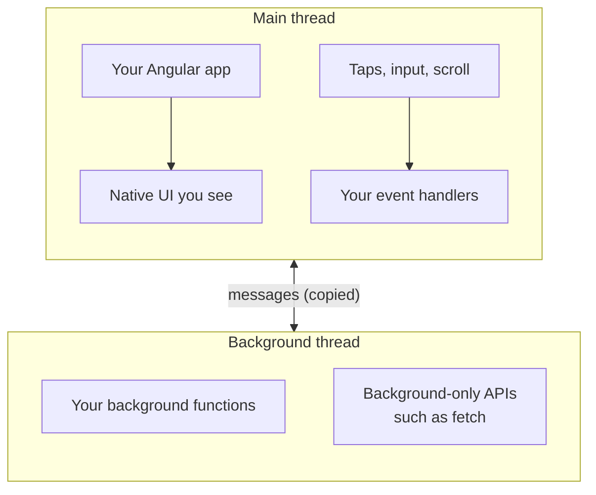

# Threads: where your code runs

Lynx runs JavaScript on two threads. AngularLynx runs your app on one of them, and uses the other to reach APIs your app's thread doesn't have. You can write most components without thinking about this. It matters for a few APIs that exist on only one thread.

## Two threads instead of one

In a browser, your JavaScript shares one thread with layout and painting. A long task blocks the page.

Lynx gives JavaScript two separate threads:

- The [**main thread**](/guide/glossary#main-thread) creates and updates the native UI, and receives touches first. It has a small set of APIs.
- The [**background thread**](/guide/glossary#background-thread) is a fuller JavaScript environment. Some APIs, such as `fetch`, exist only here.

The threads don't share memory. They can only send each other messages, and every message is copied, which takes time.

## Where AngularLynx runs your code

Your Angular app runs on the main thread. The background thread doesn't load it: it loads AngularLynx's side of each bridge and your [background functions](/api/main-thread/background-fn), and runs only what the main thread asks of it.



- **Your app draws the UI on the main thread.** Its templates become the native elements on screen.
- **Your event handlers run on the main thread**, right when the native event fires. That's why a tap gets a response without waiting for the other thread.
- **The background thread runs calls for your app.** Some AngularLynx services, such as [`LynxLogger`](/guide/debugging) and [`LynxNativeModule`](/api/angular-lynx/native-module), send calls there for you. Your own code gets there through a [background function](/api/main-thread/background-fn).

Constructors, `ngOnInit` and effects run once, like in a browser.

## Event handlers

**Inside an event handler, do what you'd do on the web.** Change signals, navigate, open overlays and start animations, straight away.

```typescript
import { Component, inject, signal } from '@angular/core';
import { Router } from '@angular/router';
import { LYNX_ELEMENTS } from '@blotch/angular-lynx';

@Component({
  selector: 'app-item',
  imports: [LYNX_ELEMENTS],
  template: `
    <view (bindtap)="open()">
      <text>{{ label() }}</text>
    </view>
  `,
})
export class Item {
  readonly label = signal('Open details');
  readonly #router = inject(Router);

  open(): void {
    this.label.set('Opening…');
    this.#router.navigate(['/details']);
  }
}
```

- **Angular updates the screen after the handler returns.** Setting a signal marks the view as changed, and the router builds the next screen a moment later, as on the web.
- **You don't need `setTimeout`.** Older versions of this guide said to wrap navigation, overlays and animations in it. Measured on Lynx 4.1 on iOS, Android and the web preview, a handler can create and remove elements, flush them to the screen and navigate without a crash. On iOS and Android, so can a [gesture](/guide/gestures/) callback.

## APIs that live on one thread

| You want to                                 | Thread it needs | What to do                                                                                                                                              |
| ------------------------------------------- | --------------- | ------------------------------------------------------------------------------------------------------------------------------------------------------- |
| Update the UI                               | Main            | Change signals. Angular does the rest                                                                                                                   |
| Make network requests                       | Background      | Use `HttpClient` or `fetch` from anywhere. AngularLynx sends the requests to the background thread. See [HTTP requests](/guide/http)                    |
| Move an element on every frame, e.g. a drag | Main            | Use a [main-thread script](/guide/main-thread/)                                                                                                         |
| Load a font at runtime                      | Background      | Call `LynxFont.addFont()` from anywhere. AngularLynx sends it to the background thread. See [Custom fonts](/guide/custom-fonts/#load-a-font-at-runtime) |
| Call your host app's native code            | Background      | Use [`LynxNativeModule`](/api/angular-lynx/native-module). AngularLynx sends the calls to the background thread                                         |

## Related

- [How a Lynx app runs](/guide/concepts/how-it-runs)
- [Signals and change detection](/guide/concepts/signals)
- [Renderer internals](/guide/renderer-architecture): how the app starts on each thread, in detail.
