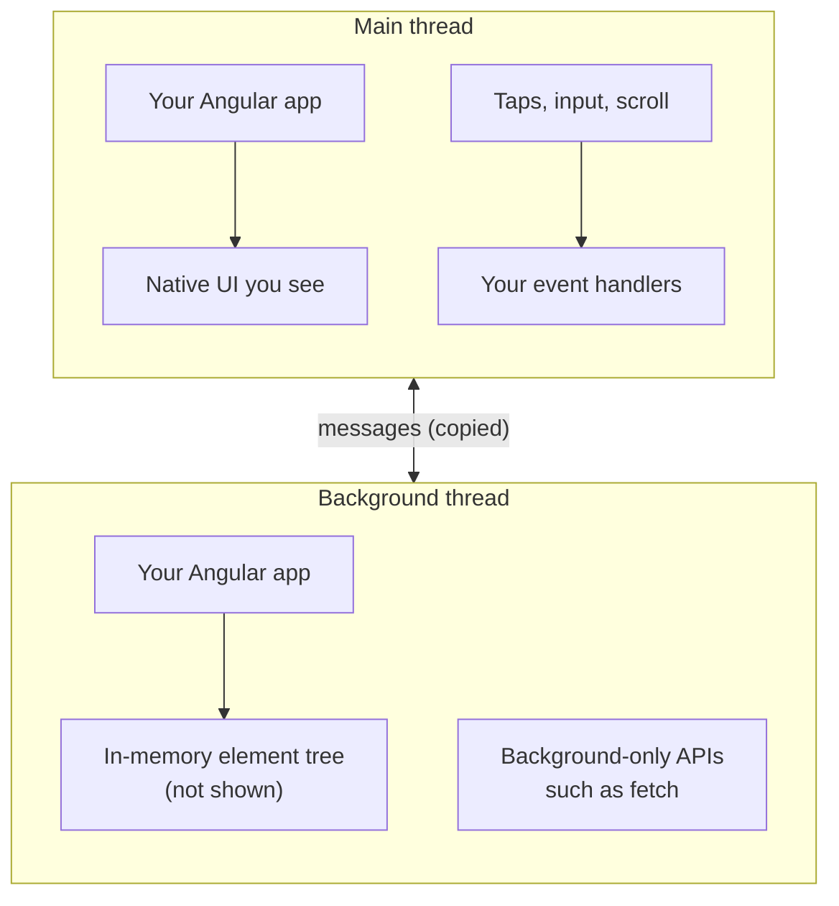

# Threads: where your code runs

Lynx runs JavaScript on two threads, and AngularLynx starts your app on both. You can write most components without thinking about this. It matters in two places: one rule for event handlers, and a few APIs that exist on only one thread.

## Two threads instead of one

In a browser, your JavaScript shares one thread with layout and painting. A long task blocks the page.

Lynx gives JavaScript two separate threads:

- The [**main thread**](/guide/glossary#main-thread) creates and updates the native UI, and receives touches first. It has a small set of APIs.
- The [**background thread**](/guide/glossary#background-thread) is a fuller JavaScript environment. Some APIs, such as `fetch`, exist only here.

The threads don't share memory. They can only send each other messages, and every message is copied, which takes time.

## Where AngularLynx runs your code

Your bundle contains your app twice, one copy for each thread. Both copies start when the app opens.



- **The main-thread copy draws your UI.** Its templates become the native elements on screen.
- **Your event handlers run on the main thread**, right when the native event fires. That's why a tap gets a response without waiting for the other thread.
- **The background-thread copy builds its views in memory only.** AngularLynx uses it to reach APIs the main thread doesn't have. [`LynxLogger`](/guide/debugging), for example, sends your logs to the dev server from there.

Because both copies start, code in a constructor or `ngOnInit` runs once on each thread. Most code doesn't care. Be careful with one-time side effects, such as counting app launches.

## The `setTimeout` rule

**Inside an event handler, change signals freely. Defer anything that creates or destroys views straight away.**

```typescript
import { Component, inject, signal } from '@angular/core';
import { Router } from '@angular/router';
import { LYNX_ELEMENTS } from '@blotch/angular-lynx';

@Component({
  selector: 'app-item',
  imports: [LYNX_ELEMENTS],
  template: `
    <view (bindtap)="open()">
      <text>{{ label() }}</text>
    </view>
  `,
})
export class Item {
  readonly label = signal('Open details');
  readonly #router = inject(Router);

  open(): void {
    // Safe: Angular updates the screen after the handler returns.
    this.label.set('Opening…');

    // Deferred: navigating creates and destroys views.
    setTimeout(() => this.#router.navigate(['/details']));
  }
}
```

### Why

A handler runs synchronously inside the native event. While it runs, Lynx is in the middle of delivering that event, and its element tree must not change.

- **Setting a signal is safe.** It only marks the view as changed. Angular re-renders after the handler returns.
- **Some calls change the tree immediately.** Making them inside the handler can crash the app or leave the screen blank.

`setTimeout(() => …)` runs the call just after the event finishes, which is safe.

### What to defer

Wrap these in `setTimeout` when you call them from an event handler:

- Router navigation: `router.navigate()`, `router.navigateByUrl()`, `location.back()`.
- Opening an overlay from code: `LynxPortal.open()` and `openTemplate()`. See [Dialogs and overlays](/guide/overlays).
- Starting an animation from code: `element.animate()`. See [Animate from code](/guide/animations/programmatic).

Template changes driven by signals, such as `@if`, `@for` and class bindings, never need it.

## APIs that live on one thread

| You want to                                 | Thread it needs | What to do                                                                                                                                              |
| ------------------------------------------- | --------------- | ------------------------------------------------------------------------------------------------------------------------------------------------------- |
| Update the UI                               | Main            | Change signals. Angular does the rest                                                                                                                   |
| Make network requests                       | Background      | Not supported from components yet. See [Network requests](/guide/concepts/javascript-environment#network-requests)                                      |
| Move an element on every frame, e.g. a drag | Main            | Use a [main-thread script](/guide/main-thread/)                                                                                                         |
| Load a font at runtime                      | Background      | Call `LynxFont.addFont()` from anywhere. AngularLynx sends it to the background thread. See [Custom fonts](/guide/custom-fonts/#load-a-font-at-runtime) |

## Related

- [How a Lynx app runs](/guide/concepts/how-it-runs)
- [Signals and change detection](/guide/concepts/signals)
- [Renderer internals](/guide/renderer-architecture): how both threads boot, in detail.
