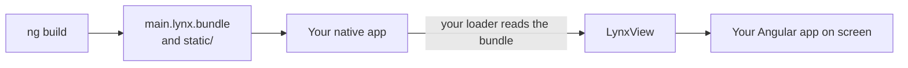
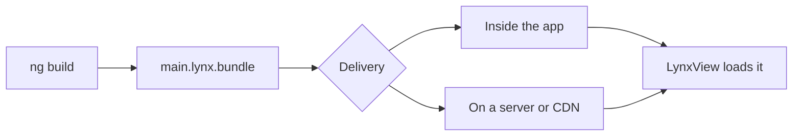

# Embed in an existing native app

Already have an iOS or Android app? Show your Angular app as one or more screens inside it, instead of shipping the app that `ng build --platform` generates.

:::info This page needs native code
Embedding means changing your iOS or Android project, in Swift, Objective-C, Kotlin or Java. It's the one place in these docs where you need native knowledge. Work through it with whoever maintains your native app.
:::

## How it fits together

Your native app adds the Lynx engine, and shows your bundle in a [**LynxView**](/guide/glossary#lynxview): a native view that runs a Lynx bundle, like an `<iframe>` for Lynx content. You place a LynxView in your own screens, as you would any other native view.



Your native app becomes the [host app](/guide/glossary#host-app): the app that loads your bundle and shows it. Build the bundle with plain `ng build`, as in [Build your app](/guide/building-for-production).

## Add Lynx to your app

Lynx's guides cover the native setup:

- [Integrate with Existing Apps](https://lynxjs.org/guide/start/integrate-with-existing-apps) adds the Lynx engine to your project. Pick your platform from the tabs.
- [Embedding LynxView into Native View](https://lynxjs.org/guide/embed-lynx-to-native) sizes a LynxView inside your own screens.

The apps `ng build --platform` generates use Lynx 4.1.0, the version AngularLynx is tested with.

## What your app must do

Beyond Lynx's own setup, your app has three jobs.

### Load the bundle

The Lynx engine doesn't fetch bundles itself. Your app gives it a **loader** that reads them from the app or from the network: a `LynxTemplateProvider` on iOS, or an `AbsTemplateProvider` on Android. Lynx's integration guide shows one for each platform.

### Serve `static/`

Images and fonts your code imports load from `/static/...` paths. Either:

- **ship `static/` inside your app,** and resolve `/static/...` paths against where you keep it, as the generated apps do; or
- **host it on a server,** and set RSpeedy's `output.assetPrefix` to its URL:

```typescript title="lynx.config.ts"
import { defineConfig } from '@blotch/angular-lynx-build';

export default defineConfig({
  output: { assetPrefix: 'https://cdn.example.com/my-app/' },
});
```

### Link XElement

:::warning Link XElement, or some elements render nothing
`<input>`, `<textarea>`, `<overlay>`, `<svg>`, `<blur-view>`, `<viewpager>`, `<refresh>`, the `<scroll-coordinator>` family, `<webview>` and `<video>` aren't part of Lynx's core. They come from Lynx's [**XElement**](/guide/glossary#xelement) library.

An app that doesn't link XElement and register its elements renders nothing for these tags. On Android, the elements after them can disappear too. Nothing on screen says why.

- **Android:** add `org.lynxsdk.lynx:xelement`, and call `addBehaviors(XElementBehaviors().create())` on the `LynxViewBuilder`.
- **iOS:** add the `XElement` pod.

Lynx's [integration guide](https://lynxjs.org/guide/start/integrate-with-existing-apps) has the details. The apps `ng build --platform` generates already do this, and so does Lynx Explorer.
:::

Before iOS 26, the [glass components](/dolan/glass#materials-before-ios-26) draw UIKit's blur materials, which XElement's `<blur-view>` doesn't have, and from iOS 26 their glass [materializes, dissolves and morphs](/dolan/glass#morphing), which XElement's sets at once. The iOS app `ng build --platform ios` generates adds both with a `<blur-view>` of its own, [`BlurView.swift`](https://github.com/Blotch-Smart-Frames/AngularLynx/blob/master/packages/native/templates/ios/App/BlurView.swift), and the [`GlassTransitions.swift`](https://github.com/Blotch-Smart-Frames/AngularLynx/blob/master/packages/native/templates/ios/App/GlassTransitions.swift) it uses. To get them in your app, copy both files and register `BlurView` for `blur-view` in place of XElement's `LynxUIBlurView`. Without them, the components draw Lynx's older blur instead, and their glass comes and goes at once.

On iOS, XElement's `<webview>` keeps its web view after the element goes, and with it the WebContent process WebKit started for it: every `<webview>` your app shows stays for as long as the app runs. Its loader and its web view keep each other. The iOS app `ng build --platform ios` generates wraps XElement's loader so the web view goes with the element, in [`WebViewLoader.swift`](https://github.com/Blotch-Smart-Frames/AngularLynx/blob/master/packages/native/templates/ios/App/WebViewLoader.swift). To get it in your app, copy the file and call `ShellWebViewLoaderProvider.register()` before your first `LynxView`, where you register XElement's elements.

## Bundled or downloaded

Your app can ship the bundle inside it, or download it from a server:



| Strategy                                | Pros                                          | Cons                                        |
| --------------------------------------- | --------------------------------------------- | ------------------------------------------- |
| **Bundled:** ship it inside the app     | Loads instantly, works offline                | Changing the app needs a store update       |
| **Downloaded:** host it on a server/CDN | Update without a store release, run A/B tests | Needs the network, at least on first launch |

You can combine both: ship a bundle with the app for an instant first launch, then check for a newer one in the background.

Before you serve updates this way:

- **Match the Lynx version.** A bundle only runs on a Lynx engine at least as new as its `targetSdkVersion`, an AngularLynx plugin option that defaults to `3.2`. Every installed version of your app must be able to run what you serve. So raise `targetSdkVersion` only when every installed version's engine is that new.
- **Check the store rules.** Both stores have rules about code an app downloads after review. Read Apple's [App Review Guidelines](https://developer.apple.com/app-store/review/guidelines/) and Google Play's [Developer Program Policies](https://play.google.com/about/developer-content-policy/) before you rely on it.

## Connect the Android back button

In the Android app `ng build --platform android` generates, the back button goes back a screen through Angular's Router, and leaves the app from the first screen. Your own Android app can do the same in three steps:

1. **Register a native module named `AngularLynxShell`**, with a `setBackHandlerEnabled(enabled: Boolean)` method. The runtime calls it with `true` while the router has a screen to go back to, and with `false` back on the first screen.
2. **Handle back while it's enabled**, with an `OnBackPressedCallback` that starts disabled. Android decides whether your app handles back as soon as the gesture starts, too early to ask JavaScript, so the runtime tells your app ahead of time.
3. **Send the `angularLynxBack` global event** to the LynxView when the callback runs. The runtime calls `Location.back()`.

```kotlin
class MainActivity : ComponentActivity() {
    private val lynxView by lazy {
        LynxViewBuilder().apply {
            // Your loaders, as in Lynx's integration guide.
            registerModule("AngularLynxShell", AngularLynxShell::class.java, this@MainActivity)
        }.build(this)
    }

    // Disabled until the router has history, so back leaves the screen.
    val backHandler = object : OnBackPressedCallback(false) {
        override fun handleOnBackPressed() {
            lynxView.sendGlobalEvent("angularLynxBack", JavaOnlyArray())
        }
    }

    override fun onCreate(savedInstanceState: Bundle?) {
        super.onCreate(savedInstanceState)
        onBackPressedDispatcher.addCallback(this, backHandler)
        // Show lynxView and load your bundle, as before.
    }
}

class AngularLynxShell(context: Context, param: Any?) : LynxModule(context, param) {
    private val activity = param as MainActivity

    // Lynx calls native modules off the main thread.
    @LynxMethod
    fun setBackHandlerEnabled(enabled: Boolean) {
        activity.runOnUiThread { activity.backHandler.isEnabled = enabled }
    }
}
```

Without the module, the back button does whatever your app already does. iOS has no back button, so there's nothing to connect there.

## Free the memory screens leave behind

PrimJS, the engine that runs your Angular code, collects garbage as the app runs, but those collections leave behind much of what a screen leaves when it goes, so the app's memory grows with every screen it shows. A full collection frees it. Lynx runs one, on every LynxView, when your app reports memory pressure with `LynxEnv.trimMemory`, and leaves it to your app to report it. The apps `ng build --platform` generates do two things, which your app can copy:

1. **Report the system's memory warnings**, and leaving the screen, where a collection's pause can't show.
2. **Register a native module named `AngularLynxShell`** with a `collectGarbage()` method that reports moderate pressure. The runtime calls it once the app has released about a screen's worth of elements and gone a second without releasing more, at most every 10 seconds. On Android, it's the same module as the back button's.

```swift
// iOS: in your app delegate and scene delegate.
func applicationDidReceiveMemoryWarning(_ application: UIApplication) {
  LynxEnv.sharedInstance().trimMemory(.critical)
}

func sceneDidEnterBackground(_ scene: UIScene) {
  LynxEnv.sharedInstance().trimMemory(.moderate)
}

// Registered with config.register(AngularLynxShell.self).
final class AngularLynxShell: NSObject, LynxModule {
  static var name: String { "AngularLynxShell" }
  static var methodLookup: [String: String] {
    ["collectGarbage": NSStringFromSelector(#selector(collectGarbage))]
  }

  override init() { super.init() }
  init(param: Any) { super.init() }

  // Lynx calls native modules off the main thread.
  @objc func collectGarbage() {
    DispatchQueue.main.async { LynxEnv.sharedInstance().trimMemory(.moderate) }
  }
}
```

```kotlin
// Android: in your Application. Lynx's MemoryPressureLevel is 1 for moderate
// and 2 for critical.
override fun onTrimMemory(level: Int) {
    super.onTrimMemory(level)
    val critical = level >= ComponentCallbacks2.TRIM_MEMORY_COMPLETE
    LynxEnv.inst().trimMemory(if (critical) 2 else 1)
}

// In the AngularLynxShell module.
@LynxMethod
fun collectGarbage() {
    Handler(Looper.getMainLooper()).post { LynxEnv.inst().trimMemory(1) }
}
```

Without the module, the runtime asks once, and never again.

## Sign in with a web page

[`LynxWebAuthSession`](/guide/web-sign-in) calls a native module named `AngularLynxWebAuth`. To use it in your own app, register one with a `start(request, callback)` method:

- **`request`** holds `url`, `callbackScheme` and `ephemeral`.
- **`callback`** takes one map: `{ url }`, the whole URL the page redirected to on `callbackScheme`, or `{ error, message }`, where `error` is `canceled` or `failed`. Call it once per `start()`.

The apps `ng build --platform` makes have one you can copy: `WebAuthModule.swift`, which uses `ASWebAuthenticationSession`, and `WebAuthModule.kt`, which opens a Custom Tab and has the activity catch the redirect as a deep link. Both are in AngularLynx's `packages/native/templates`. Without the module, `start()` rejects with `unavailable`.

## Keep data after the app closes

[`LynxLocalStorage` and `LynxSecureStorage`](/guide/persistent-storage) call native modules named `AngularLynxLocalStorage` and `AngularLynxSecureStorage`. To use them in your own app, register each with these methods. Keys and values are strings: the runtime stores values as JSON.

- **`getItem(key, callback)`** calls back with `{ value }`, or `{}` if there's nothing stored under `key`.
- **`setItem(key, value, callback)`**, **`removeItem(key, callback)`** and **`clear(callback)`** call back with `{}` once they're done.
- **On failure,** any of them calls back with `{ error }`, a message, which the runtime rejects with. Call the callback once per call.

The apps `ng build --platform` makes have them to copy, in AngularLynx's `packages/native/templates`: `LocalStorageModule.swift` and `LocalStorageModule.kt` use `UserDefaults` and `SharedPreferences`, `SecureStorageModule.swift` uses the Keychain, and `SecureStorageModule.kt` encrypts each value with a key the Android Keystore holds. Without the modules, both services keep values in memory, which lasts until the app closes.

## Open links outside the app

[`LynxLinking`](/guide/open-links) calls a native module named `AngularLynxLinking`. To use it in your own app, register one with these methods:

- **`openURL(url, callback)`** opens `url` where the system opens it, and calls back with `{}` once it's handed over.
- **`openInApp(url, options, callback)`** shows an `http` or `https` `url` in a browser sheet over the app, and calls back with `{}` once the person is back. `options` may hold `toolbarColor` and `controlsColor`, each a `#` and eight hex digits: red, green, blue and alpha.
- **`canOpenURL(url, callback)`** calls back with `{ value }`, `true` when something on the device opens `url`.
- **On failure,** any of them calls back with `{ error: 'failed', message }`. Call the callback once per call.

The apps `ng build --platform` makes have one you can copy: `LinkingModule.swift`, which uses `UIApplication.open` and `SFSafariViewController`, and `LinkingModule.kt`, which sends an `ACTION_VIEW` intent and opens a Custom Tab, given the activity as its param. Both are in AngularLynx's `packages/native/templates`. List the schemes `canOpenURL` asks about in your Info.plist's `LSApplicationQueriesSchemes` and your manifest's `<queries>`. Without the module, `openURL()` and `openInApp()` reject with `unavailable`, and `canOpenURL()` resolves `false`.

## Let someone pick a photo

[`LynxImagePicker`](/guide/image-picker) calls a native module named `AngularLynxImagePicker`. To use it in your own app, register one with a `pick(options, callback)` method:

- **`options`** holds `maxDimension` and `quality` when the app passes them. With either, re-encode the photo as a JPEG, upright and scaled down to `maxDimension`.
- **`callback`** takes one map: `{ base64, name, type }`, the photo's bytes as base64 with a file name and a MIME type, `{ canceled: true }` when the person closed the picker, or `{ error: "failed", message }`. Call it once per `pick()`.

The apps `ng build --platform` makes have one you can copy: `ImagePickerModule.swift`, which uses `PHPickerViewController` and ImageIO, and `ImagePickerModule.kt`, which has the activity open the Photo Picker. Both are in AngularLynx's `packages/native/templates`. Without the module, `pick()` rejects with `unavailable`.

## Open the share sheet

[`LynxShare`](/guide/share) calls a native module named `AngularLynxShare`. To use it in your own app, register one with a `share(request, callback)` method:

- **`request`** holds `files`, a list of `{ base64, name, type }` (each file's bytes as base64, its name and its MIME type, which may be empty), and `title`, `text` and `url` when the app passes them.
- **`callback`** takes one map: `{ shared: true }` once the person has shared, `{ shared: false }` when they closed the sheet, or `{ error: "failed", message }`. Call it once per `share()`.

The apps `ng build --platform` makes have one you can copy: `ShareModule.swift`, which writes the files to temporary files and opens `UIActivityViewController`, and `ShareModule.kt`, which shares them through a `FileProvider` (declared in the template's `AndroidManifest.xml`, with `res/xml/share_paths.xml`), given the activity as its param. Both are in AngularLynx's `packages/native/templates`. For "Save Image" on iOS, your Info.plist needs `NSPhotoLibraryAddUsageDescription`; without it, the iOS module leaves the action out. Without the module, `share()` rejects with `unavailable`.

## Pass data from your app

Your native app can send values into Angular, such as a signed-in user's ID or the app's theme. See [Pass data from your native app](/guide/embedding/host-data).

## Related

- [Pass data from your native app](/guide/embedding/host-data)
- [Multi-page apps](/guide/multi-page): several bundles, each in its own LynxView.
- [Build your app](/guide/building-for-production)
- [Integrate with Existing Apps](https://lynxjs.org/guide/start/integrate-with-existing-apps) on lynxjs.org
