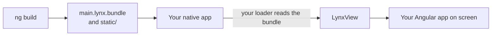
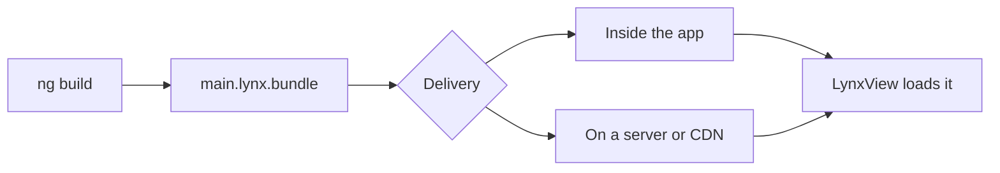

# Embed in an existing native app

Already have an iOS or Android app? Show your Angular app as one or more screens inside it, instead of shipping the app that `ng build --platform` generates.

:::info This page needs native code
Embedding means changing your iOS or Android project, in Swift, Objective-C, Kotlin or Java. It's the one place in these docs where you need native knowledge. Work through it with whoever maintains your native app.
:::

## How it fits together

Your native app adds the Lynx engine, and shows your bundle in a [**LynxView**](/guide/glossary#lynxview): a native view that runs a Lynx bundle, like an `<iframe>` for Lynx content. You place a LynxView in your own screens, as you would any other native view.



Your native app becomes the [host app](/guide/glossary#host-app): the app that loads your bundle and shows it. Build the bundle with plain `ng build`, as in [Build your app](/guide/building-for-production).

## Add Lynx to your app

Lynx's guides cover the native setup:

- [Integrate with Existing Apps](https://lynxjs.org/guide/start/integrate-with-existing-apps) adds the Lynx engine to your project. Pick your platform from the tabs.
- [Embedding LynxView into Native View](https://lynxjs.org/guide/embed-lynx-to-native) sizes a LynxView inside your own screens.

The apps `ng build --platform` generates use Lynx 4.1.0, the version AngularLynx is tested with.

## What your app must do

Beyond Lynx's own setup, your app has three jobs.

### Load the bundle

The Lynx engine doesn't fetch bundles itself. Your app gives it a **loader** that reads them from the app or from the network: a `LynxTemplateProvider` on iOS, or an `AbsTemplateProvider` on Android. Lynx's integration guide shows one for each platform.

### Serve `static/`

Images and fonts your code imports load from `/static/...` paths. Either:

- **ship `static/` inside your app,** and resolve `/static/...` paths against where you keep it, as the generated apps do; or
- **host it on a server,** and set RSpeedy's `output.assetPrefix` to its URL:

```typescript title="lynx.config.ts"
import { defineConfig } from '@blotch/angular-lynx-build';

export default defineConfig({
  output: { assetPrefix: 'https://cdn.example.com/my-app/' },
});
```

### Link XElement

:::warning Link XElement, or some elements render nothing
`<input>`, `<textarea>`, `<overlay>`, `<svg>`, `<blur-view>`, `<viewpager>`, `<refresh>`, the `<scroll-coordinator>` family, `<webview>` and `<video>` aren't part of Lynx's core. They come from Lynx's [**XElement**](/guide/glossary#xelement) library.

An app that doesn't link XElement and register its elements renders nothing for these tags. On Android, the elements after them can disappear too. Nothing on screen says why.

- **Android:** add `org.lynxsdk.lynx:xelement`, and call `addBehaviors(XElementBehaviors().create())` on the `LynxViewBuilder`.
- **iOS:** add the `XElement` pod.

Lynx's [integration guide](https://lynxjs.org/guide/start/integrate-with-existing-apps) has the details. The apps `ng build --platform` generates already do this, and so does Lynx Explorer.
:::

## Bundled or downloaded

Your app can ship the bundle inside it, or download it from a server:



| Strategy                                | Pros                                          | Cons                                        |
| --------------------------------------- | --------------------------------------------- | ------------------------------------------- |
| **Bundled:** ship it inside the app     | Loads instantly, works offline                | Changing the app needs a store update       |
| **Downloaded:** host it on a server/CDN | Update without a store release, run A/B tests | Needs the network, at least on first launch |

You can combine both: ship a bundle with the app for an instant first launch, then check for a newer one in the background.

Before you serve updates this way:

- **Match the Lynx version.** A bundle only runs on a Lynx engine at least as new as its `targetSdkVersion`, an AngularLynx plugin option that defaults to `3.2`. Every installed version of your app must be able to run what you serve. So raise `targetSdkVersion` only when every installed version's engine is that new.
- **Check the store rules.** Both stores have rules about code an app downloads after review. Read Apple's [App Review Guidelines](https://developer.apple.com/app-store/review/guidelines/) and Google Play's [Developer Program Policies](https://play.google.com/about/developer-content-policy/) before you rely on it.

## Connect the Android back button

In the Android app `ng build --platform android` generates, the back button goes back a screen through Angular's Router, and leaves the app from the first screen. Your own Android app can do the same in three steps:

1. **Register a native module named `AngularLynxShell`**, with a `setBackHandlerEnabled(enabled: Boolean)` method. The runtime calls it with `true` while the router has a screen to go back to, and with `false` back on the first screen.
2. **Handle back while it's enabled**, with an `OnBackPressedCallback` that starts disabled. Android decides whether your app handles back as soon as the gesture starts, too early to ask JavaScript, so the runtime tells your app ahead of time.
3. **Send the `angularLynxBack` global event** to the LynxView when the callback runs. The runtime calls `Location.back()`.

```kotlin
class MainActivity : ComponentActivity() {
    private val lynxView by lazy {
        LynxViewBuilder().apply {
            // Your loaders, as in Lynx's integration guide.
            registerModule("AngularLynxShell", AngularLynxShell::class.java, this@MainActivity)
        }.build(this)
    }

    // Disabled until the router has history, so back leaves the screen.
    val backHandler = object : OnBackPressedCallback(false) {
        override fun handleOnBackPressed() {
            lynxView.sendGlobalEvent("angularLynxBack", JavaOnlyArray())
        }
    }

    override fun onCreate(savedInstanceState: Bundle?) {
        super.onCreate(savedInstanceState)
        onBackPressedDispatcher.addCallback(this, backHandler)
        // Show lynxView and load your bundle, as before.
    }
}

class AngularLynxShell(context: Context, param: Any?) : LynxModule(context, param) {
    private val activity = param as MainActivity

    // Lynx calls native modules off the main thread.
    @LynxMethod
    fun setBackHandlerEnabled(enabled: Boolean) {
        activity.runOnUiThread { activity.backHandler.isEnabled = enabled }
    }
}
```

Without the module, the back button does whatever your app already does. iOS has no back button, so there's nothing to connect there.

## Pass data from your app

Your native app can send values into Angular, such as a signed-in user's ID or the app's theme. See [Pass data from your native app](/guide/embedding/host-data).

## Related

- [Pass data from your native app](/guide/embedding/host-data)
- [Multi-page apps](/guide/multi-page): several bundles, each in its own LynxView.
- [Build your app](/guide/building-for-production)
- [Integrate with Existing Apps](https://lynxjs.org/guide/start/integrate-with-existing-apps) on lynxjs.org
