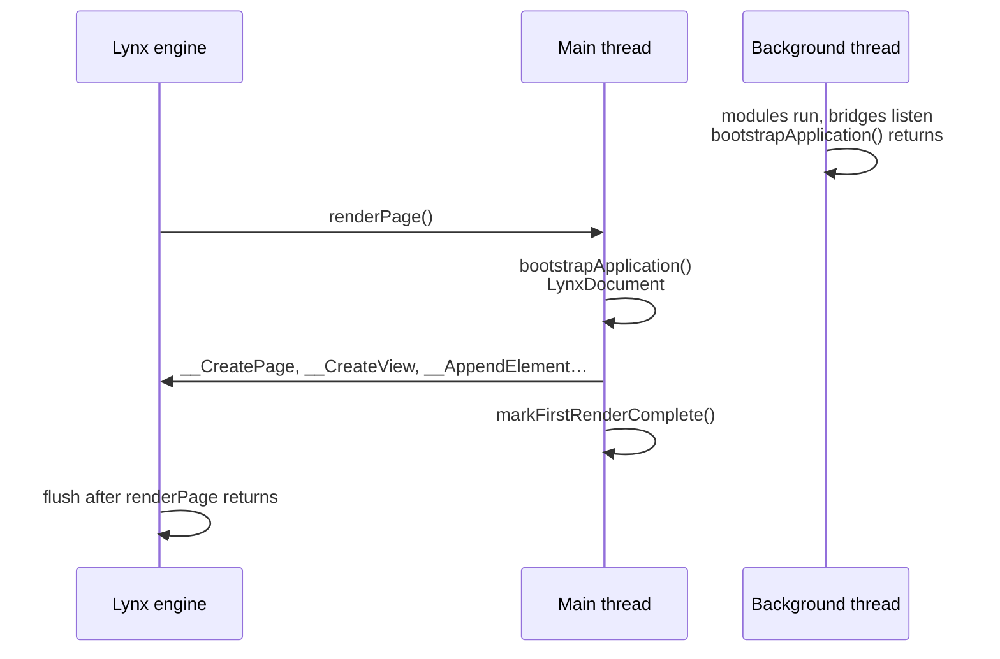

# Renderer internals

This page explains how AngularLynx turns Angular's rendering calls into native Lynx elements. It's for contributors and the curious: you don't need it to build an app. The source is in `packages/runtime/src/lib`, mainly `renderer/`, `lynx-document/`, `lynx-element/`, `router/` and `runtime.ts`.

## Two bundles from one source

Apps install `@blotch/angular-lynx-build`. Its builders add the internal build plugin, `@blotch/rsbuild-plugin-angular-lynx`, to [RSpeedy](/guide/glossary#rspeedy), Lynx's build tool. The plugin builds two entries for each of the app's:

| Entry               | Thread     | Starts from                                      | Output                 | `__MAIN_THREAD__` |
| ------------------- | ---------- | ------------------------------------------------ | ---------------------- | ----------------- |
| `main__main-thread` | Main       | Your `main.ts`                                   | `main-thread.js`       | `true`            |
| `main`              | Background | A generated entry with your background functions | `background-thread.js` | `false`           |

Both are packed into one [bundle](/guide/glossary#bundle), `main.lynx.bundle`. The plugin replaces `__MAIN_THREAD__` with each half's value as it compiles, so shared code can check which thread it runs on, and the other thread's branch is left out. Your stylesheets are taken from the main-thread half, which imports them all.

- **The [main thread](/guide/glossary#main-thread)** runs PrimJS, a QuickJS-based engine, and its code ships as bytecode. Older Lynx code calls this runtime **Lepus**.
- **The [background thread](/guide/glossary#background-thread)** runs PrimJS on Android and JavaScriptCore on iOS.
- **On the web**, `@lynx-js/web-core` runs the main thread in an iframe and the background thread in a Web Worker.

## Angular boots on the main thread

`bootstrapApplication()` from `@blotch/angular-lynx` starts Angular on the main thread. The background half doesn't call it (see [Threads](/guide/concepts/threads) for what this means for app code):

- **The main thread** waits for the engine to call the global `renderPage()`, then bootstraps with a `LynxDocument`.
- **The background thread** doesn't load the app. Its half of the bundle starts from an entry the build plugin generates, which loads the runtime, whose bridges start listening, and each file that calls `backgroundFn()`, `createMainThreadRef()` or `new MainThreadRef()` at module level, so each function registers. Angular and your components aren't in it.
- **Before any module runs**, on both threads, the build's first entry module adds the built-in methods the engine lacks, up to ES2026, such as `.at()` and `toSorted()` ([JavaScript language level](/guide/concepts/javascript-environment#javascript-language-level)).
- **Before either**, the runtime installs its globals: `onerror` handlers that forward to `_ReportError`, polyfills (timers from `lynx.setTimeout`, `URL`, `queueMicrotask`), and the registry for [main-thread scripts](/guide/glossary#main-thread-script).

**`LynxDocument`** creates real native elements through Lynx's element functions (`__CreateView`, `__SetAttribute`, …).

Earlier versions booted a second copy of the app on the background thread, on an in-memory document. Nothing read its elements, but its constructors, `ngOnInit` hooks and effects ran, so shared side effects happened twice.

## Reaching the background thread

The background thread has APIs the main thread lacks, such as `fetch`, `NativeModules`, `lynx.getJSModule()` and `lynx.requestResourcePrefetch()`. The main thread reaches them with Lynx's event channels: it dispatches on `lynx.getJSContext()`, and the background thread replies on `lynx.getCoreContext()`.

- **`backgroundFn()` and `runOnBackground()`** call your own functions.
- **`callOnBackground()`** (`background-call.ts`) calls the APIs AngularLynx's services use: fonts, accessibility, exposure, session storage, resource prefetching, native modules and JS modules. Function arguments, such as a native module's callback, are sent as markers, and the background thread calls them back on the main thread.
- **The main thread's `fetch` and `XMLHttpRequest`** (`network/`) send each request through `callOnBackground()` to the background thread's `fetch`. Bodies cross as text, or as base64 when they're bytes, and an `AbortSignal` aborts the background request too. `HttpClient` uses them like the browser's.
- **`LynxLogger`** relays log entries to a listener that posts them to the dev server.

The background thread finds a function by ID, so both threads must give it the same one. The build plugin gives each module-level `backgroundFn()` and `MainThreadRef` an ID from its file and position (`cross-thread-transform.ts`).

The plugin finds those files in Angular's compiled output, and in installed packages that depend on `@blotch/angular-lynx`, and writes the background entry to import them (`background-entry.ts`). A file the main thread loads lazily, such as a lazy route's, loads at startup on the background thread, so its functions are registered before the route opens.

## How Renderer2 maps onto Lynx

`LynxRenderer` implements Angular's `Renderer2`. It delegates to `LynxDocument` and to `LynxElement`, a wrapper around a native element reference:

| `Renderer2` call                | What runs                                                                                                                                                              |
| ------------------------------- | ---------------------------------------------------------------------------------------------------------------------------------------------------------------------- |
| `selectRootElement()`           | `__CreatePage`                                                                                                                                                         |
| `createElement(tag)`            | The tag's creator: `__CreateView`, `__CreateText`, `__CreateImage`, `__CreateScrollView`, …, or `__CreateElement('x-…')` for [XElement](/guide/glossary#xelement) tags |
| `createText(value)`             | `__CreateRawText`                                                                                                                                                      |
| `createComment()`               | `__CreateView` with `display: none`                                                                                                                                    |
| `appendChild()`                 | `__AppendElement`                                                                                                                                                      |
| `insertBefore()`                | `__InsertElementBefore`                                                                                                                                                |
| `removeChild()`                 | Queues the removal. `__RemoveElement` runs at the end of the cycle                                                                                                     |
| `setAttribute()`                | `__SetClasses` for `class`, `__SetInlineStyles` for `style`, `__SetID` for `id`, `__SetDataset` for `data-*`, otherwise `__SetAttribute`                               |
| `setStyle()`, `removeStyle()`   | `__AddInlineStyle` (a `null` value removes)                                                                                                                            |
| `addClass()`, `removeClass()`   | `__AddClass`; `__GetClasses` then `__SetClasses`                                                                                                                       |
| `setValue()` on a text node     | `__SetAttribute(el, 'text', value)`                                                                                                                                    |
| `listen()`                      | `__AddEvent(el, eventType, name, { type: 'worklet', value: listener })`, with `eventType` from the `bind`, `catch`, `capture-` or `global-` prefix                     |
| `parentNode()`, `nextSibling()` | `__GetParent`, `__NextElement`                                                                                                                                         |

A few choices behind the table:

- **Comment anchors are hidden views.** Angular inserts `@if`, `@for` and `createComponent()` content next to comment nodes. Lynx's non-element node crashes the tree functions Angular calls on anchors, so a `display: none` view stands in.
- **Unknown tags become views.** Component host elements such as `<app-card>` go through `createElement()`, and they need to be real layout boxes. A component that called `registerHostElement()` gets the element it registered instead, such as a `<text>`: `createElement()` only sees the tag, so the registration is keyed by the component's selector.
- **`<list>` is special.** It returns a `LynxListElement`, whose children the engine requests through a `componentAtIndex` callback instead of `__AppendElement`.
- **Native references can't be hashed.** Using one as a `Map`, `Set` or `WeakSet` key crashes the main-thread engine. Wrappers are keyed by `__GetElementUniqueID()` instead.
- **`listen()` adds no-op `stopPropagation()` and `preventDefault()`** to event objects that lack them, so Angular's own listener wrapper doesn't throw.

## Emulated and None renderers

`LynxRendererFactory2.createRenderer()` picks a renderer per component type:

- **`ViewEncapsulation.None`**, or no type: one shared `LynxRenderer`.
- **`ViewEncapsulation.Emulated`**, the default: one `EmulatedLynxRenderer` per component, keyed by its `ɵcmp.id`. It adds a `_ngcontent-<id>` class to every element it creates, and a `_nghost-<id>` class to each host element of the component.
- **`ViewEncapsulation.ShadowDom`**: logs a warning and falls back to `LynxRenderer`.

The browser's emulated renderer adds `_ngcontent-*` and `_nghost-*` attributes, and Angular's compiler scopes the component's selectors with them. Lynx's CSS engine can't match attribute selectors, so the build plugin turns them into class selectors and sets each component's `ɵcmp.id` to the scope ID the CSS was compiled with, made from its class name and file path. Elements keep their scope classes when Angular replaces their whole class list.

## The flush cycle

Element functions change the engine's element tree right away, but nothing is laid out or drawn until **`__FlushElementTree()`** runs. Angular calls `begin()` and `end()` on the renderer factory around every change-detection cycle. `end()` runs, in this order:

1. **`processPendingRemovals()`** commits queued removals with `__RemoveElement`.
2. **`processPendingTextNormalization()`** trims edge spaces from text runs that changed.
3. **`__FlushElementTree()`** commits everything to the screen.
4. **`processPendingListUpdates()`** tells each `<list>` that gained or lost children, then flushes that list.

Reversing steps 3 and 4 leaves list items empty, or re-enters the flush and crashes.

**The first render isn't flushed by `end()`.** Bootstrap's change detection still runs inside the engine's `renderPage()` call. A promise continuation doesn't escape it, because the engine drains microtasks before the call returns. So `end()` skips step 3 until `markFirstRenderComplete()`, and the engine flushes once `renderPage()` returns. Work that must not run inside that call, such as a list's first layout, waits for a `setTimeout`. `@lynx-js/web-core` has no flush after `renderPage()`, so on the web the runtime schedules one.

**Changes outside a cycle get a settle flush.** `scheduleSettleFlush()` queues one microtask that commits removals, text and a flush. It runs when:

- an element is created outside a cycle, such as a lazy route's component that `RouterOutlet` builds during navigation
- an event handler returns, in case it changed elements directly without changing a signal
- a removed element is rebuilt

It's skipped inside a cycle, because `end()` will flush, and during the first render. Main-thread scripts batch their own changes into one flush on a microtask.

## How a tap reaches the screen

Change detection is zoneless (see [Signals and change detection](/guide/concepts/signals)). A tap runs like this:

1. The engine calls the global `runWorklet()` on the main thread with the listener that `listen()` registered.
2. The listener runs your handler synchronously, inside the native event.
3. Your handler sets a signal. Angular marks the view dirty, and its zoneless scheduler queues a tick, racing `setTimeout` against `requestAnimationFrame`. Lynx puts its timers on `lynx`, so the runtime copies them onto `globalThis` at startup.
4. When the handler returns, `scheduleSettleFlush()` queues a microtask for any direct element changes.
5. The tick runs change detection. The renderer calls element functions, and `end()` flushes.

Changing the tree in step 2 is safe, though the engine is still delivering the event: a handler can create and remove elements, and even flush them with `ApplicationRef.tick()`. A navigation changes it later anyway, since the router builds the next screen after the handler returns.

## Removal, moves and rebuilding

Angular moves a view by removing it and inserting it again in the same tick. `remove()` only queues the element, so an insert in the same tick cancels the removal. The engine sees a move, and the native element keeps its subtree.

A removal that isn't undone before the flush destroys the element's native view, and Lynx can't bring it back. So every `LynxElement` caches what was set on it: attributes, id, dataset, classes, styles, listeners, text and children. Inserting a destroyed element rebuilds it, and its subtree, from that cache. This is how content shown again by an `@if`, or a route you return to, still renders.

## Route views

`provideRouter()` keeps Angular's own route reuse strategy, so leaving a route destroys its components, as on the web.

It used to install `LynxRouteReuseStrategy`, which keeps every route's view alive. An early crash investigation had blamed a native element pool of about 256 slots that removing an element never freed. Measured on Lynx 4.1 in the iOS Simulator and an Android emulator, there's no such limit: 400 navigations between two pages of 300 elements created over 121,000 native elements, with no crash. The strategy saved none of them, because a reattached route rebuilds its elements from cache (see above). It's still exported, for apps that want route state to survive navigation.

## Routing without a browser

`provideRouter()` from `@blotch/angular-lynx` wraps Angular's and swaps two providers:

- **`LynxPlatformLocation`** replaces `BrowserPlatformLocation`, which reads `window.location` and crashes on Lynx. It keeps location state in memory, parses URL strings by hand, and reports `href` as `lynx://app/…`. It needs its own `@Injectable()`: without one, Angular inherits `PlatformLocation`'s factory and builds the browser class.
- **`LynxLocationStrategy`** replaces `PathLocationStrategy`. It keeps a history stack and an index in memory. `back()` and `forward()` move the index and notify `popstate` listeners.

It also sets `resolveNavigationPromiseOnError: true`, so a failed navigation resolves to `false` instead of rejecting. Unhandled rejections there used to leave a blank screen. Listen for `NavigationError` to see failures.

The main thread has no `URL` class, and since Angular 22.2 the router's URL serializer calls `new URL()`. Without it, every URL serialized to `/` and no navigation happened. The runtime installs a `URL` and `URLSearchParams` polyfill that follows the web's URL Standard.

## Related

- [Threads: where your code runs](/guide/concepts/threads)
- [Signals and change detection](/guide/concepts/signals)
- [Routing and navigation](/guide/routing)
- [Main-thread scripts](/guide/main-thread/)
- [`@blotch/angular-lynx-build` reference](/api/build/)
